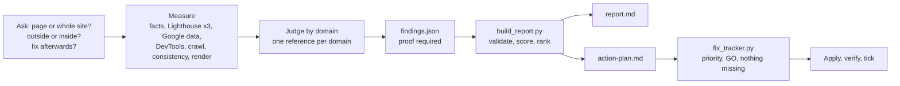

# Site Audit

🇬🇧 **English** · 🇫🇷 [Français](README.fr.md)

**One skill that audits a web page or a whole site, tells you what works and what is wrong, hands you one scored report with proof for every line, then applies the fix plan with your GO.**

Technical, SEO, speed, UX, accessibility, conversion (CRO), copywriting, security, tracking, AI visibility. It asks whether you want one page or the whole site, measures with real tools, and refuses to write a finding it cannot prove.

> An open skill made by **[Kavyro.com](https://kavyro.com)**, the community for learning to work with AI agents.

Examples (on fictional sites, in French): [full audit, outside + inside](examples/community-site/) · [the agent applies a plan](examples/fix-session/)

## Why this one

Most audit prompts give you a long list of generic advice, then leave you alone. This skill is built around five rules:

- **Measure first, judge second.** Scripts collect the facts (HTML, headers, Lighthouse, a real crawl, rendered screens). The model only interprets measured data.
- **Proof or refused.** Every finding carries a value and a source file, a severity, an effort, an impact and a confidence level (`measured`, `deduced`, `hypothesis`). A validation script rejects the report if a finding has no evidence.
- **What works is part of the audit.** Each audited domain lists at least one verified strength. No report made only of complaints.
- **One report and one action plan, always the same shape.** The report: verdict in one sentence, scores, top 5 priorities, detail by domain, what was not measured, method. The plan: quick wins this week, projects this month, the rest later, numbered by priority, each with an owner, steps, a way to verify, the risk, the rollback and what the agent needs to apply it. Scores are computed by a script, so the same findings always give the same score.
- **The agent fixes, but never without you.** It applies the plan in priority order, **one action at a time, with your GO**, and **only when it has everything it needs**. Otherwise it asks you for the missing piece, once, before acting.

## What it audits

| Domain | Looks at |
|---|---|
| Technical | status codes, redirects, canonical host, robots.txt, sitemaps, noindex, soft 404, JavaScript rendering |
| SEO | title, meta description, headings, duplicates, internal links, images, structured data, social tags |
| Speed | Lighthouse x3 (median), **fresh Google data (PageSpeed Insights) and real-visitor data (CrUX) with its date and scope**, several pages at once (Unlighthouse), DevTools view of the network, culprit scripts and third parties, images |
| UX and mobile | real mobile screens while scrolling, banners covering the page, tap targets, forms |
| Accessibility | contrast, labels, alt text, structure (automated checks only) |
| Conversion | promise, call to action, proof, offer clarity, objections, friction |
| Copywriting | headline, clarity, reader focus, specificity, tone, claims, **inconsistencies** (the same service at two prices, delays or durations that contradict each other, several phones or addresses, a brand name spelled several ways, a founding year that does not add up) |
| Security | HTTP headers, mixed content, third-party scripts (passive, no probing); **with read access to the back end**: versions, outdated plugins, error logs, forgotten files, permissions, backups |
| Tracking and consent | trackers present, consent tool, **what loads before any choice, then after clicking "Reject all"** (real browser, nothing is ever accepted) |
| AI visibility | AI crawler rules, readability without JavaScript, entity markup, `llms.txt` |

## How it works



| Script | Job |
|---|---|
| `doctor.py` | one read-only check before the first audit: what this machine can run (Python, Chrome, Lighthouse, Unlighthouse, a Google key by variable name), what each missing piece costs and how to install it |
| `facts.py` | head, headings, images, links, forms, headers, trackers, robots, sitemaps, redirects, soft 404 |
| `lh_median.py` | Lighthouse in series, median, spread, culprits (idle machine only: a busy one lies) |
| `psi.py` | Google's own fresh lab run plus real-visitor (CrUX) data, with its scope (this page or the whole site), its 28-day period, its age and its trend; needs a free API key |
| `devtools.py` | what the browser's DevTools show for a first visit: network by category, cookies, console, what fires before any consent, what still fires after "Reject all" |
| `lh_site.py` | Lighthouse on several pages at once through [Unlighthouse](https://github.com/harlan-zw/unlighthouse), with the mobile CPU slowdown restored and checked |
| `crawl.py` | polite crawl (robots.txt respected), duplicates, broken links, redirect chains, orphans, sitemap gaps |
| `consistency.py` | candidate contradictions with the exact passages: the same service at two prices, different delays, several phones or addresses, brand spelled several ways, founding year that does not add up |
| `access_check.py` | read-only proof that an ssh, WordPress, FTP or folder access works, and what it allows |
| `redact.py` | masks secrets, e-mail addresses, IP addresses, phone numbers and street addresses in command output before it is kept as evidence |
| `render.py` | real screens at several scroll positions, text and buttons after JavaScript, fixed banners and the share of the screen they cover |
| `botwall.py` | used by `facts.py`, `crawl.py` and `render.py`: recognises a bot-protection page (challenge, block, verification) so it is never audited as if it were the site. It never tries to get past the protection |
| `build_report.py` | refuses unproven findings, computes scores, ranks priorities, writes `report.md` and `action-plan.md` |
| `fix_tracker.py` | the referee of the fix mode: priority order, one GO per action, nothing started with something missing, no secret stored |

Everything is Python standard library. No dependency to install except the Lighthouse CLI and a Chrome.

## Install

Requirements: Python 3.9+, Node.js, Chrome or Chromium, and the Lighthouse CLI:

```
npm install -g lighthouse
```

### In Hermes Agent

```
hermes skills install Kavyrocom/site-audit/skills/site-audit --category marketing --yes --force
```

**Why `--force`.** Hermes scans every skill that does not come from its own catalog. Without `--force` the install stops with a `CAUTION` verdict and 18 findings, 4 of them rated HIGH. That is expected for a tool that starts Chrome and Lighthouse, can call `ssh` when you give it back-end access, and hands its environment to the tools it starts. The 4 HIGH findings are copies of the environment given to Lighthouse, Unlighthouse or `git` (`lh_median.py`, `lh_site.py`, `safenet.py`) and a check on the name of a variable (`fix_tracker.py`); none of them sends anything over the network. Do not take this on trust: run the command above **without** `--force` first to read the full list, then open the scripts in `skills/site-audit/scripts/`.

If GitHub answers "rate limit", log in with `gh auth login` or set `GITHUB_TOKEN`: the unauthenticated limit is 60 requests per hour.

Check that it is installed and enabled:

```
hermes skills list | grep site-audit
```

If a Hermes session is already open, type `/reload-skills` so it sees the skill. The skill lands in `~/.hermes/skills/marketing/site-audit/`. To update it later: `hermes skills update`.

### In another agent

**With the skills CLI**

```
npx skills add Kavyrocom/site-audit
```

**Manual** (any agent that reads Agent Skills, a folder with a `SKILL.md`): copy `skills/site-audit/` into its skills folder.

```
Claude Code   ~/.claude/skills/site-audit/            (or .claude/skills/ in a project)
OpenCode      ~/.config/opencode/skills/site-audit/   (it also reads .claude/skills/ and .agents/skills/)
Others        .agents/skills/site-audit/              (the shared convention)
```

The skill follows the open [Agent Skills format](https://agentskills.io/specification) (checked with `skills-ref validate`): `SKILL.md` names no tool of any agent, and the scripts are plain Python that the agent starts from a shell. It was loaded and its preflight run from a clean project in Claude Code and in OpenCode, and installed in Hermes Agent.

## Use

### 1. Run an audit

In a Hermes conversation, just ask:

```
Audit https://example.com with the site-audit skill.
```

Or from the terminal, preloading the skill:

```
hermes chat -s site-audit -q "Audit https://example.com"
```

The agent asks its questions in one message: **only this page or the whole site** (and a page cap), **what a visitor should do** on it, mobile or desktop, **outside view only or outside + inside**, **whether you want it to fix things afterwards** and what it can reach (WordPress, site files, CDN, tag manager, code repository). Then it works on its own and ends with the verdict, the score, the top 3 priorities and the path of the files.

### Outside or inside audit

- **Outside** (default): what a visitor and Google see. No access needed.
- **Outside + inside**: if you give **read** access to the back end (`ssh`, WordPress admin through an application password, FTPS/SFTP, the site folder on the machine), the agent also sees the *why*: PHP and WordPress versions, outdated or abandoned plugins, error logs, forgotten files (`.git`, `.env`, backups), permissions, database weight, scheduled jobs, backups.
- The agent **tests every access before relying on it** (`access_check.py`, read-only). If one is missing or does not work, it asks for **everything it needs in a single message**, and **does not wait** to run the outside audit. With no verified access, the report says "outside only" and puts the inside part in "not measured".
- **No secret in the chat.** You put the password or key in the agent's environment and give it the **name** of the variable. Command output goes through `redact.py` before it is kept as evidence.

The audit is **read-only**: it never submits a form, buys or changes anything. It logs in only if you give it an access for the inside view, and only to read. Audit only a site you own or are allowed to audit.

### 2. Read the result

The folder `site-audit-<site>-<date>/` contains:

| File | Content |
|---|---|
| `report.md` | verdict, scores by domain, strengths, top 5 priorities, findings with proof, what was not measured |
| `action-plan.md` | the actions numbered by priority, with checkboxes |
| `findings.json` | the structured findings (the source of the two files above) |
| `crawl/`, `lh/`, `shots/` | the raw measurements and screens, so you can check |

### 3. Have the agent apply the plan

Say: **"apply the action plan"**.

What the agent does, in this order:

1. It sets up the tracker (`fix-state.json`) with every action, by priority.
2. It lists, **in one single message**, everything it is missing: access, information, content to provide, decisions. Each item says which action it unlocks. It also asks whether this is production or a test, whether a recent backup exists, and whether anything is off limits.
3. It handles the actions **one by one, from most to least urgent**. For each ready action it shows what it changes, the risk and the rollback, then waits for your **GO**.
4. It applies, **verifies** with the check written in the plan, ticks the box and records the proof in `fix-log.md`.
5. An action with a missing item is **never started**: it asks you again for the item and moves to the next ready action, if you agree.

At the end it offers to rerun the audit on the same pages and compare with the starting score. That second pass is what proves the fixes worked.

## The fix mode rules

They are enforced by a script (`fix_tracker.py`), not just requested from the model: the script refuses (exit code 2) anything that breaks them.

| Rule | What the script refuses |
|---|---|
| Priority order | approving an action while a more urgent one is still open, unless you chose to skip and your answer is recorded; skipping (`defer`) without your name and your words |
| One GO per action | ticking an action that was never approved; approving in the agent's name; approving a second action while one is approved and not finished |
| Nothing starts with something missing | approving an action when an item has not been provided |
| No secret in chat or files | storing a password or token: only the name of the environment variable is kept |
| An access is tested before it is accepted | recording an access without a fresh `access_check.py` result, marked by the script (a mark that catches a hand-edited file, not a forgery) of the right type (or, for an access no script can test, a note that says a test succeeded) |
| No "done" without proof | ticking without a note of what was checked |

Who applies what:

| Mode | Meaning |
|---|---|
| `agent` | the agent applies it after your GO, through a declared access (WordPress API, files, CDN, tag manager, repository) |
| `assisted` | the agent prepares the text, code or settings, and someone else applies them |
| `human` | a legal, brand or budget decision, or specialist work: a person does it |

Risk: **low** (reversible in a click, invisible to visitors), **medium** (visible, reversible with a backup), **high** (checkout, DNS, site-wide redirects, indexing rules, legal text). One GO covers one action, whatever its risk: the agent asks for each action in turn and waits for the answer.

The agent **never invents** a testimonial, a figure, a name or a result: proof content is something it asks you for.

## Measured result of the fix mode

A real test on a small fictional site served locally (4 pages) with deliberate flaws ([details and log](examples/fix-session/), raw figures in [`examples/benchmark/`](examples/benchmark/): the two `report.json` and `findings.json`, and `runs.json`).

| | Before | After |
|---|---|---|
| Indicative score | 87/100 | 91/100 |
| High-severity findings | 4 | 2 |
| Medium-severity findings | 5 | 3 |

- 4 exchanges with the agent. **6 of 12 actions applied and verified**, 5 waiting for something only the person can provide (real photos, reviews, the address that receives the form, contact details, tone), 1 handed to a human (server headers).
- When the person answered a decision question without saying GO, the agent **changed nothing** and asked for the GO again.
- The second audit exposed a side effect: the SEO score dropped (73 then 69), because the canonical pointed to a fictional domain that does not exist yet. That is also what the second pass is for.
- The same findings always give the same score, but two audit passes on the same site can notice different things, so a gap of a few points is within the noise. **Read the list of findings, not only the score.**
- One test site, one conversation: a demonstration, not a guarantee.

## What it costs and takes

Measured with Claude Sonnet through Claude Code in a clean environment, one run each (raw figures: [`examples/benchmark/runs.json`](examples/benchmark/runs.json)):

| Operation | Time | API-equivalent cost |
|---|---|---|
| 20-page audit, outside + inside view, [fictional community site](examples/community-site/) | about 4 min 30 s | $0.69 |
| 20-page audit, outside view, two real sites | about 3 min 50 s and 5 min 30 s | $0.39 and $0.44 |
| Test site audit (4 pages) | about 2 min 45 s | $0.37 |
| Fix conversation (4 exchanges, 6 actions applied) | about 2 min 50 s in total | about $0.50 |
| Rerun audit of the test site | about 2 min 40 s | $0.35 |

Measurement scripts cost nothing and run in seconds (Lighthouse x3 is the slow part). Only the interpretation uses the model. These are single runs: treat them as an order of magnitude, not a benchmark.

## Responsible use

- **Audit only a site you own or are allowed to audit.** The scripts visit pages and crawl up to the page cap, at most 4 requests at a time and at least 0.1 s apart, while obeying `robots.txt` (they answer to the name `SiteAuditSkill`; wildcards `*` and `$`, the longest matching rule and a rule aimed at that name are read as RFC 9309 says; a robots.txt that answers 5xx or 429, or cannot be reached, stops the crawl, sitemaps included, and a link robots.txt forbids is not requested at all). Do not loop the skill over lists of sites you do not own: it is an audit tool, not a scanner. `devtools.py` opens a real Chrome and may click the refuse button of a cookie banner it found, never a form, never a link. After that click it blocks navigations and form submissions, but the page's own scripts keep running and may still send requests of their own (analytics, beacons).
- **The audited site is treated as untrusted.** The scripts fetch only `http` and `https`, and refuse a redirect to a private address, a local service or `file://`. Every browser the skill starts (`render.py`, `devtools.py`, Lighthouse, Unlighthouse) runs behind a small local proxy (`netguard.py`) that resolves each host name itself, refuses any private, local or cloud-metadata address and connects to the address it checked: a page cannot reach an internal service by a cross-site iframe, a service worker, a WebSocket or a changing DNS answer, and the requests refused are listed in the output (Chrome is also told to send no UDP traffic outside the proxy, and each browser is stopped for good after a timeout). Not covered: the requests Unlighthouse's own process makes outside its browser (it cannot go through the proxy), so each page it is given is checked just before, and a page that redirects off the site or to a refused address is left out; a site that answers differently the second time is not covered. An audit that starts on a literal private address, on `localhost` or on a name you declare yourself in `SITE_AUDIT_ALLOW_PRIVATE_HOST` (a staging name that only resolves inside your network) may reach only that host, and the rest of loopback when it starts there; cloud-metadata and link-local addresses are never reachable. A name that merely resolves to a private address does not switch the guard off. The skill's browsers connect directly: behind a mandatory company proxy the audit cannot run. It is a net, not a sandbox: the page's code still runs in your Chrome. **Run audits as a normal user, on a machine that holds no secrets and no access to your internal network.**
- **Chrome as root.** Chrome only starts as root without its sandbox, which makes a hostile page more dangerous. The scripts say so when it happens.
- **Inside view.** Read-only, secrets only by variable name. `redact.py` masks known patterns (tokens, passwords, keys, cookies, connection strings) and personal data (e-mail addresses, IP addresses except loopback, phone numbers, fields such as `user_login` or `billing_email`). It cannot mask a person's name in free text or in a table such as `wp user list`: count instead. It is a net, not a guarantee: read an evidence file before you share it. `build_report.py` refuses a report that contains a secret, and refuses personal data when the audit has an inside view.
- **Keep the audit folder out of git.** The audit writes `site-audit-<host>-<date>/` (evidence, screenshots, inside outputs). Create it outside any repository, and never publish it or the report of a site that is not yours. The scripts add a `.gitignore` containing `*` at the top of that folder, but only a folder named like that (`site-audit-<host>-<date>`): they never touch another one, and they warn when the folder sits in a repository that does not ignore it.
- **Personal data.** With an inside view the audit can read data about people (users, visitors, customers). You become responsible for it under the GDPR: ask for counts and roles, not names, and delete the folder when you are done. The permission question of Step 0 is a declaration in the conversation: no script can verify that you are allowed to audit a site.
- **Fix mode.** `fix_tracker.py` enforces the order, the GO and the missing items. `init` requires `--owner NAME`, the person who gives the GO; `approve` and `defer` (skipping an action) accept only that name, and refuse agent names and role words (`owner`, `client`, `yes`...). One GO covers one action: the tracker refuses a second `approve` while one is approved and not finished, but it cannot know whether you really asked the person again before each one: a GO for several actions at once ("go for P1 and P2") is not a GO, and that part is the agent's to keep. The check on names only catches obvious ones (agents, tools, role words): the GO still has to come from a person. An access is accepted only from a fresh `access_check.py --out` file (marked by the script, so a hand-edited file is caught but a forgery is not, of the type the need declares), and `--ref` must be the name of a variable that exists in the environment. This is a guard for an honest agent, not a security boundary: an agent that can run any command can still edit the state file, and the proof of an access is declarative. The trail is the name written in `fix-log.md`. Keep a backup before any medium or high-risk action.
- **Nothing here certifies compliance or predicts a gain.** The report says what was measured, what was read and what was not looked at.

## Limits, said plainly

- Lighthouse numbers are **lab** measurements, made at the time of the audit. Real-visitor data (CrUX) is a 28-day aggregate: it is **not fresh**, it moves slowly after a fix, and it exists only if the page has enough traffic (otherwise only the whole site, and the report says so). `psi.py` needs a **free Google API key**; without one that data is "not measured". INP only exists in that real-visitor data.
- A site whose protection (Cloudflare, Sucuri, Akamai and similar) stops the audit machine cannot be audited from outside: the scripts recognise the challenge or block page, say so and stop. They never try to get past it. Ask the owner to allow the audit machine's address, or audit a copy of the site.
- The crawl sees the initial HTML. JavaScript-rendered sites are flagged, and `render.py` reads the rendered page for the audited URL only.
- Conversion and copy findings are **judgements** (`deduced`), not measurements. They come with a quote or a screen and a test to confirm them.
- Scores are indicative: a transparent penalty model (critical 40, high 20, medium 8, low 3, reduced to 70% when deduced and 40% when hypothesis), not a standard. Two passes on the same site can differ by a few points.
- Accessibility checks are automated and partial. Nothing here certifies legal compliance (WCAG, GDPR, EAA).
- Tracking before consent is observed by `devtools.py` in a real Chrome, in one pass, from the machine running the audit: a banner can change with the visitor's country. It is not legal advice.
- Inconsistencies (`consistency.py`) are **candidates with both passages quoted**: the agent re-reads them and keeps only real contradictions. On a JavaScript-built site only the initial HTML is read.
- Unlighthouse (`lh_site.py`) is for **screening** slow pages, one run each; confirm the worst two or three with `lh_median.py`.
- The fix mode was tested on static HTML files. On a real WordPress site or CDN, reliability depends on the access you give: with no access, every action becomes ready-to-apply instructions (`assisted`).
- You stay responsible for what the agent changes on your site: keep a recent backup before any medium or high-risk action.

## Develop

```
python3 -I -m unittest discover -s tests
```

320 offline tests: a local fixture site for the crawler and the facts script, the validator, the scoring and the action plan, the fix mode rules (order, GO, missing items, secrets), the consistency detector (planted contradictions, and things that only look like contradictions), a fake Google server for `psi.py` (freshness, page versus whole-site scope, stale data, missing key), a real Chrome for `devtools.py` (cookies, third parties, the refuse-button test) and for rendering (skipped when Chrome is missing), the access checks (a throwaway `sshd` when available), and the secret masking. A hostile-input suite covers redirects to `file://` and private addresses (by redirect, by script, by sitemap), a robots rule aimed at the crawler, a refuse button inside a form or tied to one, secrets in notes, and a hostile page that tries to reach an internal service from a real Chrome (cross-site iframe, service worker, WebSocket, prefetch) or a robots.txt rule built to stall the crawler. `python3 -I tests/mutation_check.py` breaks 96 rules one at a time on a copy of the repository, first checks that the untouched copy is green, and counts a mutant as caught only when a test fails on a check, not when the mutant merely crashes the code.

## Credits

**Made by [Kavyro.com](https://kavyro.com)**, the community for learning to work with AI agents.

The structure and domain checklists were informed by reading these excellent projects. No code or text was copied: the references are written from scratch.

- [coreyhaines31/marketingskills](https://github.com/coreyhaines31/marketingskills)
- [addyosmani/web-quality-skills](https://github.com/addyosmani/web-quality-skills)
- [AgriciDaniel/claude-seo](https://github.com/AgriciDaniel/claude-seo)
- [seo-skills/seo-audit-skill](https://github.com/seo-skills/seo-audit-skill)
- [squirrelscan/squirrelscan](https://github.com/squirrelscan/squirrelscan)

Speed data comes from [Lighthouse](https://github.com/GoogleChrome/lighthouse), Google's [PageSpeed Insights API](https://developers.google.com/speed/docs/insights/v5/get-started) and Chrome UX Report, and, for several pages at once, [Unlighthouse](https://github.com/harlan-zw/unlighthouse) (suggested by a community member). None of them is bundled.

## License

MIT. Made by [Kavyro.com](https://kavyro.com).
